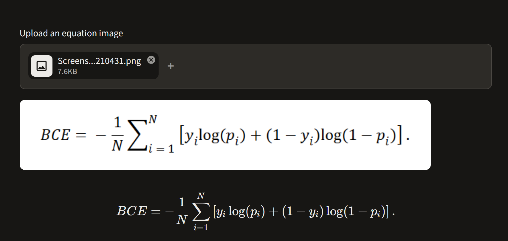

# LaTeX OCR with Local Vision-Language Model

Turning equation image to editable latex 

## Demo



## Project Structure

```text
latex_ocr_with_llama/
├── ocr.py          # <1-line description>
├── app.py          # <1-line description>
├── img.png         # Sample equation image
├── pyproject.toml  # Project dependencies (uv)
└── uv.lock         # Locked dependency versions
```

## Prerequisites

- Python <version>
- [`uv`](https://docs.astral.sh/uv/)
- NVIDIA GPU with CUDA (2 GB VRAM recommended)
- Hugging Face account & access token

## Quickstart

1. **Install dependencies:**
   ```bash
   uv sync
   ```

2. **Configure environment variables:**
   Create a `.env` file in the project root:
   ```env
   HUGGING_FACE_ACCESS_TOKEN=your_token_here
   ```

3. **Run the Streamlit app:**
   ```bash
   uv run streamlit run app.py
   ```

4. *(Optional)* **Test via CLI:**
   ```bash
   uv run python ocr.py
   ```
